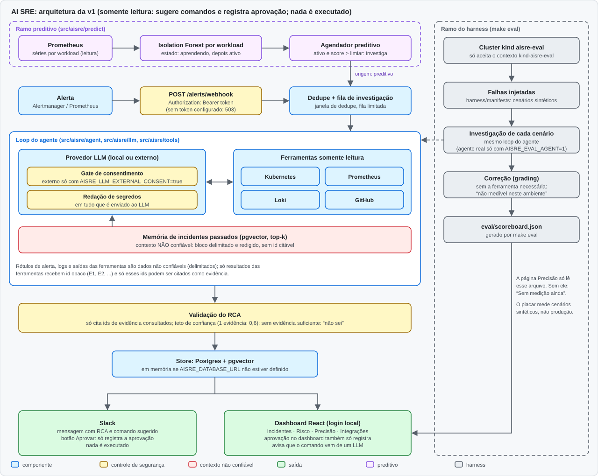

# AI SRE

🇧🇷 [Português](README.md) (the canonical, most detailed version) · 🇺🇸 English (this file)

Evidence-backed root cause analysis (RCA) for Kubernetes incidents. It receives Alertmanager alerts, investigates with
**read-only** tools (Kubernetes, Prometheus, Loki, GitHub) driven by an LLM you bring, and returns an RCA that cites the
evidence it actually consulted, or says "I don't know". It ships a React dashboard (Portuguese UI), Slack publishing
with an approve button, and a predictive module (Isolation Forest over Prometheus metrics).

**v1 is read-only.** The product only *suggests* commands and *records* a human approval. Nothing is ever executed.
Single-tenant, installed with Helm, Apache-2.0. Not a hosted service and not monetized.

## Current status (read before using)

- **Verified so far:** the test suite (fake backends), chart rendering with a real `helm`, the release workflow, and
  the evaluation harness (`make eval`, `make eval-full`) against a real `kind` cluster in Docker.
- **Not verified yet:** `helm install` against a real production-like cluster, Postgres with pgvector in production, real
  Slack (signature and approve button), the dashboard in a real browser, and any real user. Expect rough edges.
- **Accuracy: only a preliminary, noisy measurement.** See below. Do not treat it as the product's accuracy.
- The UI and user-facing texts are in **Portuguese** only for now. Contributions for i18n are welcome.

## Principles

- **Read-only:** tools only read; commands are suggested, never run. The chart's RBAC is `get/list/watch` only.
- **Evidence or "I don't know":** only evidence ids from real queries can be cited; invented references are dropped;
  with a single piece of evidence confidence is capped at 0.6; without citable evidence the result is "I don't know".
- **Bring your own LLM, with consent:** an external LLM is used only with explicit consent
  (`AISRE_LLM_EXTERNAL_CONSENT`, default `false`) and every text sent is secret-redacted. A "local" endpoint outside a
  private network is treated as external.
- **Untrusted data is delimited:** alert labels, logs, tool output and past-incident memory are data, never instructions.
- Details in [SECURITY.md](SECURITY.md) (Portuguese).

## Try it

Run the API locally (the dashboard is served at `/` if `web/dist` exists):

```bash
python3.12 -m venv .venv && .venv/bin/pip install -e '.[dev]'
npm --prefix web ci && npm --prefix web run build
export AISRE_ADMIN_PASSWORD_HASH="$(.venv/bin/python -m aisre.auth hash)"
export AISRE_SESSION_SECRET="$(.venv/bin/python -m aisre.auth secret)"
export AISRE_WEBHOOK_TOKEN="$(.venv/bin/python -m aisre.auth secret)"
export AISRE_SESSION_COOKIE_SECURE=false          # only for http://localhost
export AISRE_LLM_PROVIDER=local AISRE_LLM_BASE_URL=http://localhost:11434 AISRE_LLM_MODEL=qwen2.5:7b
.venv/bin/uvicorn aisre.api.main:create_app --factory --port 8000
```

To see the dashboard with synthetic data only (no cluster, no LLM): `.venv/bin/python scripts/demo_server.py`.

## Install on Kubernetes

Helm chart in [deploy/helm/aisre](deploy/helm/aisre/README.md): Secrets by reference (`existingSecret`), Alertmanager
with a Bearer token, optional Ingress and NetworkPolicy. Images and chart are published to GHCR on each `vX.Y.Z` tag:
`ghcr.io/marcocristofolini/ai-sre:X.Y.Z` and `oci://ghcr.io/marcocristofolini/charts/aisre`. There is no `latest` tag.

## Architecture



Alertmanager (or the predictive scheduler) opens an incident → the agent talks to the LLM through the consent gate and
redaction, calling read-only tools → the answer is validated (real evidence ids, confidence cap, "I don't know") → the
RCA is stored (Postgres + pgvector, in-memory without a database) and shown in Slack and the dashboard. The predictive
branch runs one Isolation Forest per workload over Prometheus history ("learning" → "active").

## Measured accuracy (preliminary)

Run on 2026-11-24 with `kind` + Docker, 7 synthetic failure scenarios injected into a real cluster
(OOMKilled, crash loop from bad config, bad deploy raising latency, DNS failure, gradual memory leak, latency creep, node
disk pressure), one run per scenario. **These are not product accuracy figures**: tiny sample, high run-to-run variance.

| Run | Tools | Model | Correct |
|---|---|---|---|
| `make eval` (baseline) | kubernetes | none ("unknown") | 0 / 4 |
| `make eval` | kubernetes | `qwen2.5:7b` (Ollama, CPU) | 1 / 4 |
| `make eval-full` | kubernetes, prometheus, loki | `qwen2.5:7b` (Ollama, CPU) | 0 / 7 (provider timeouts) |
| `make eval-full` | kubernetes, prometheus, loki | `nvidia/nemotron-3.5-super-vl-120b-a12b` | 1 / 7, then 3 / 7 |

In the 3 / 7 run the agent was right on OOM, crash loop and DNS; it described only the symptom (OOM) for the gradual leak;
answered "ephemeral-storage exhaustion with eviction" for disk pressure (probably a false negative of the grader's
synonym list, deliberately not tuned after seeing the result); and said "I don't know" for the two latency scenarios
(not yet investigated). The same model scored 1 / 7 and 3 / 7 in two runs, so a trustworthy number needs repeated runs
per scenario and more scenarios. Reproduce with `make eval` / `make eval-full` (see the Portuguese README for the
environment variables and chart versions).

## Contributing

See [CONTRIBUTING.md](CONTRIBUTING.md), the [code of conduct](CODE_OF_CONDUCT.md) and the
[CHANGELOG](CHANGELOG.md). Issues and PRs may be in English or Portuguese. Security reports: see
[SECURITY.md](SECURITY.md).

License: Apache-2.0 (see `LICENSE` and `NOTICE`).
