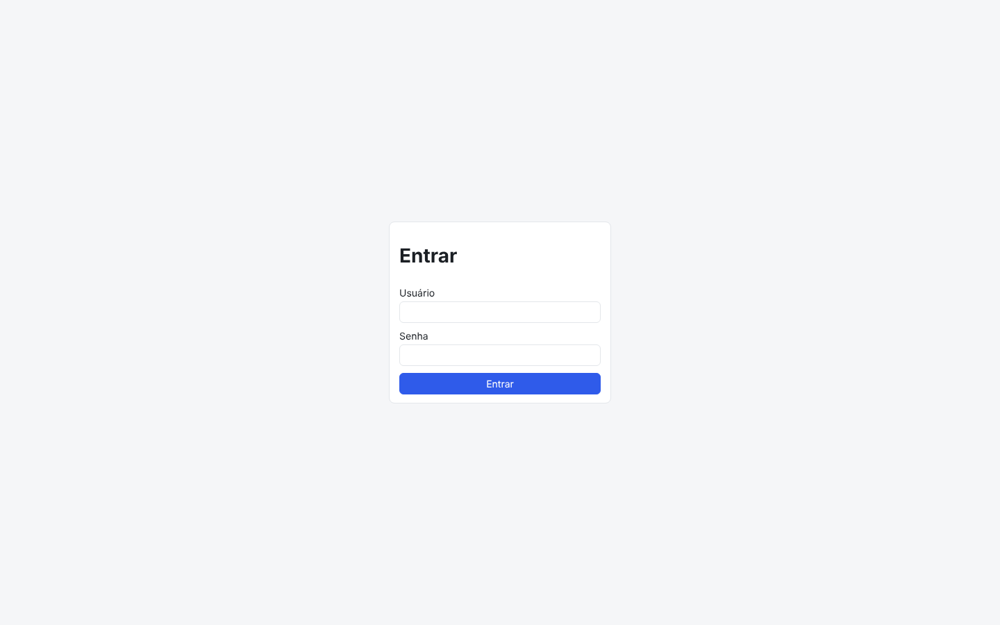
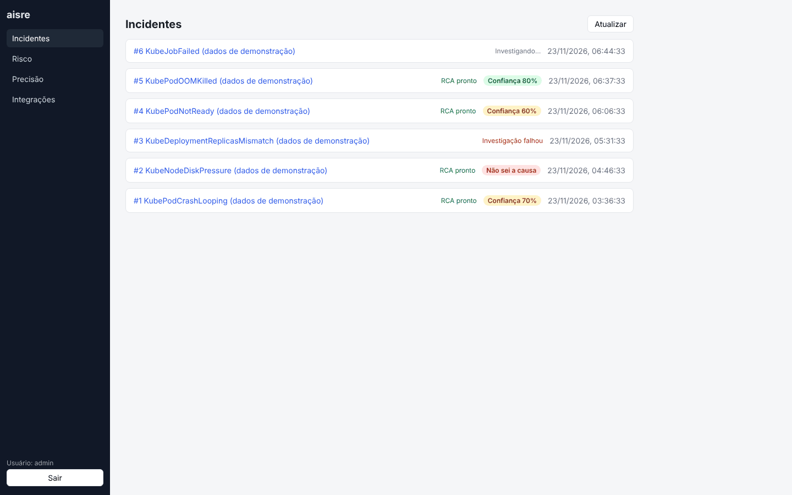
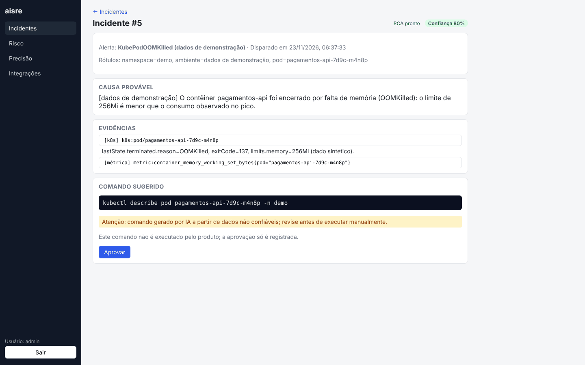
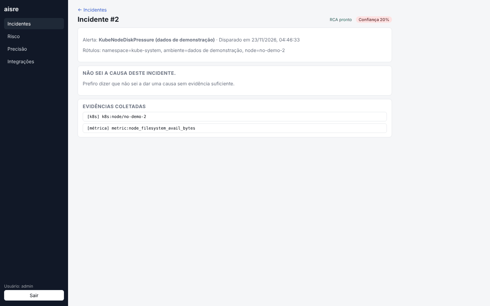
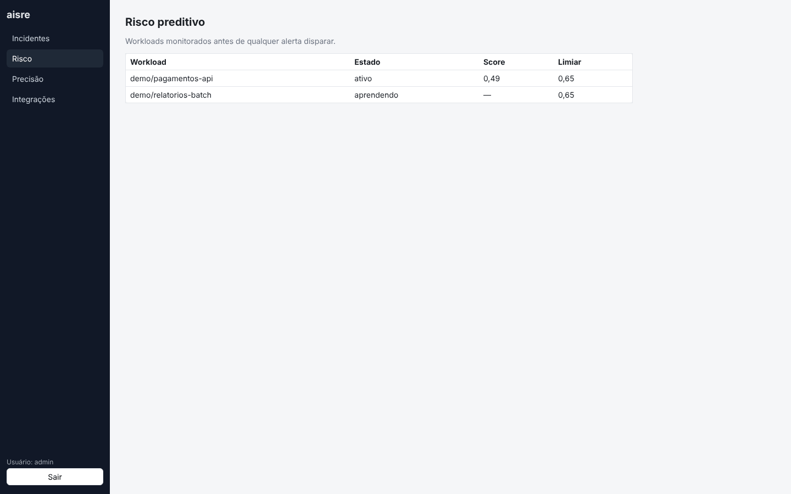
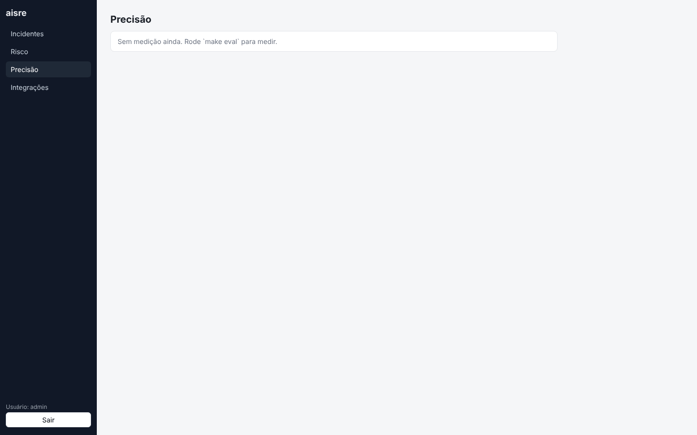
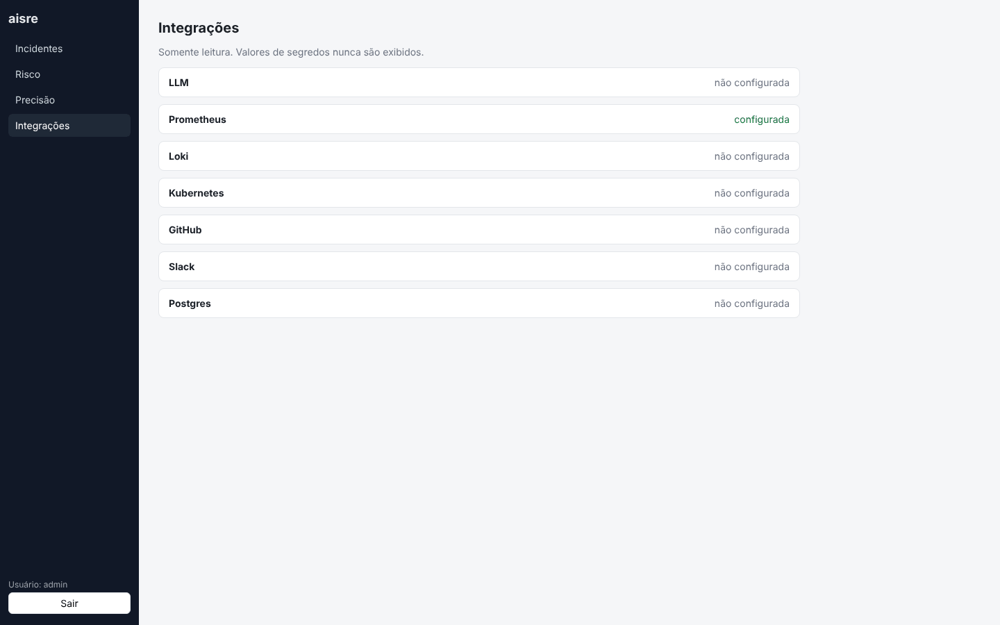
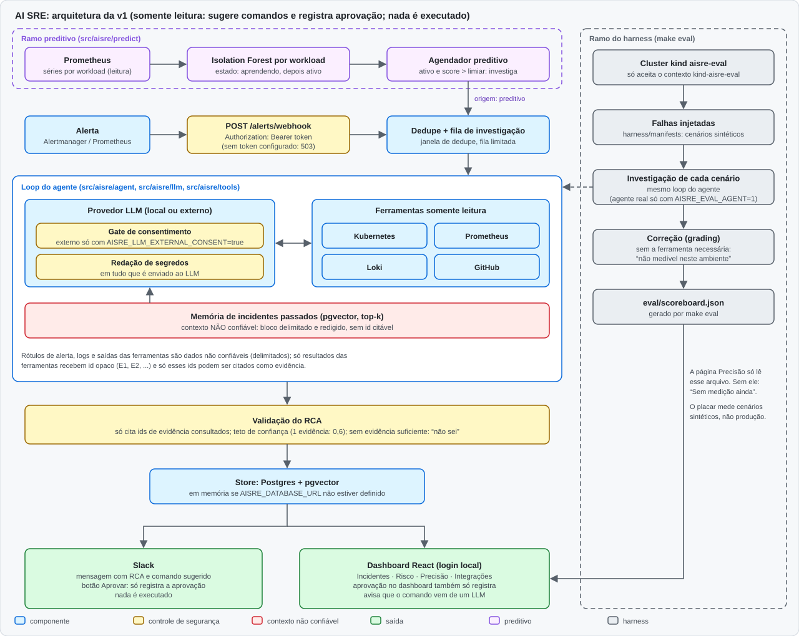
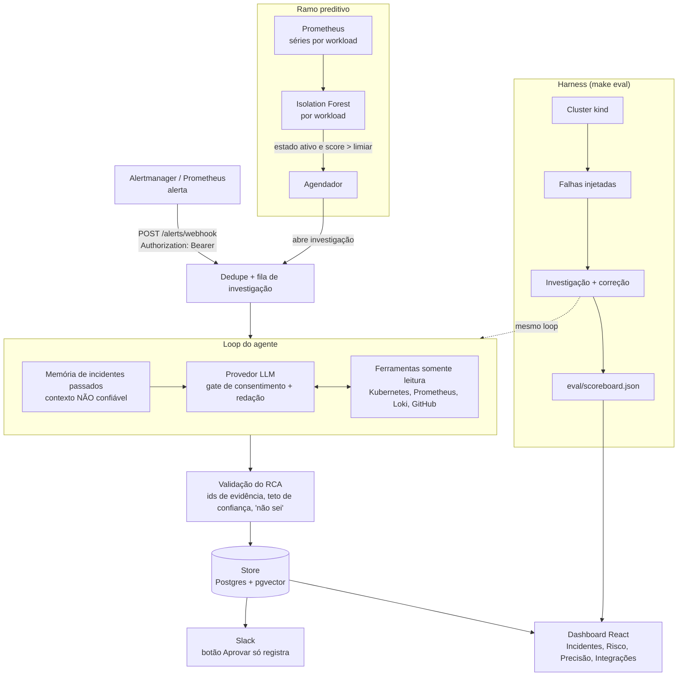

# AI SRE

Análise de causa raiz (RCA) de incidentes de Kubernetes com evidências. Recebe alertas do Alertmanager, investiga
com ferramentas **somente leitura** (Kubernetes, Prometheus, Loki, GitHub) guiadas por um LLM e entrega um RCA que
cita as evidências consultadas — ou diz "não sei". Inclui um dashboard (React), publicação no Slack com botão de
aprovação e um módulo preditivo (Isolation Forest sobre métricas do Prometheus).

**v1 é somente leitura**: o produto só *sugere* comandos e *registra* a aprovação humana. Nada é executado.

## Estado atual (leia antes de usar)

- **NÃO verificado em cluster real**, com modelo real nem com o chart Helm instalado. Os testes usam backends falsos
  (MockTransport, clientes Kubernetes falsos, LLM roteirizado). O `helm template` não foi executado no ambiente de
  desenvolvimento; o `make eval` (cluster `kind`) também não.
- **Não existe ainda nenhuma medição de precisão.** O placar (`make eval`) nunca foi rodado com um modelo real; a
  página Precisão mostra "Sem medição ainda" até existir um placar. O placar mede cenários sintéticos de falha
  injetada, não produção, e cenários que exigem ferramentas ausentes (Prometheus, Loki, GitHub não vêm no `kind`)
  aparecem como "não medível neste ambiente", fora do total.
- **Memória de incidentes é usada pelo agente**: RCAs conclusivos são salvos com embedding local (hashing, sem rede;
  pgvector no Postgres) e cada investigação recebe os `AISRE_MEMORY_TOP_K` (padrão 3; 0 desativa) incidentes
  anteriores mais parecidos como contexto **não confiável**: bloco delimitado e redigido como qualquer outro dado,
  sem id citável (nunca é evidência, não eleva a confiança nem dispensa o "não sei"). Falha na consulta é só
  registrada (tipo da exceção) e a investigação segue sem ela. O embedding é um hashing de tokens (lexical, não
  semântico) e não foi avaliado quanto à utilidade. Notas de resolução não são armazenadas; 
  runbooks: não implementado (fora do escopo da v1).
- Os testes de integração com Postgres (`tests/test_db_postgres.py`) rodam só com `AISRE_TEST_DATABASE_URL`.
- Licença: Apache-2.0 (veja `LICENSE` e `NOTICE`; copyright 2026 Marco Fabricio Cristofolini).

## Screenshots

Dashboard real (React, servido pela API), rodando com **dados de demonstração** sintéticos gerados por
[`scripts/demo_server.py`](scripts/demo_server.py) (`.venv/bin/python scripts/demo_server.py`, com `web/dist` construído).
Os incidentes, RCAs e séries são inventados e rotulados "dados de demonstração". **Não existe nenhuma medição de
precisão**: a captura da página Precisão mostra justamente o estado "Sem medição ainda".

| | |
|---|---|
|  <br> Login local |  <br> Lista de incidentes |
|  <br> RCA com evidências, comando sugerido, aviso de "gerado por IA" e botão Aprovar (só registra) |  <br> "Não sei a causa", com as evidências coletadas |
|  <br> Risco preditivo (um detector "aprendendo", outro "ativo") |  <br> Precisão: "Sem medição ainda" |
|  <br> Integrações (só o Prometheus, falso, está configurado na demo) | |

## Arquitetura



Mesmo fluxo em Mermaid (renderizado pelo GitHub):



Passo a passo:

1. O Alertmanager (ou o agendador preditivo) cria um incidente. O webhook exige token Bearer; alertas repetidos dentro
   da janela de deduplicação reaproveitam o incidente, e a fila de investigações é limitada.
2. O agente conversa com o LLM. Cada texto enviado passa pelo gate de consentimento (provedor externo só com consentimento
   explícito) e pela redação de segredos. O LLM só pode chamar ferramentas **somente leitura** (Kubernetes, Prometheus,
   Loki, GitHub). Incidentes anteriores parecidos entram como contexto não confiável, sem id citável.
3. A resposta é validada: só vale citar ids de evidências realmente consultadas; com uma única evidência a confiança tem teto
   (0,6); sem evidência suficiente o resultado é "não sei".
4. O RCA vai para o Store (Postgres com pgvector; em memória se `AISRE_DATABASE_URL` não existir) e é entregue no Slack
   e no dashboard. O botão **Aprovar** (Slack ou dashboard) apenas registra quem aprovou o comando sugerido.
5. Ramo preditivo: um Isolation Forest por workload aprende o histórico do Prometheus ("aprendendo") e, quando "ativo",
   o agendador abre uma investigação se o score passar do limiar. Ramo do harness: `make eval` injeta falhas num cluster
   `kind`, corrige cada cenário e escreve `eval/scoreboard.json`, que a página Precisão lê (sem arquivo: "Sem medição ainda").
   Nenhum dos dois ramos foi verificado em ambiente real (veja "Estado atual").

### Princípios de segurança

- **Somente leitura**: as ferramentas só leem; o produto sugere comandos, nunca os executa.
- **Consentimento padrão `false`** para qualquer LLM externo (`AISRE_LLM_EXTERNAL_CONSENT`).
- **Redação** de segredos em tudo que sai para o LLM.
- **Dados não confiáveis delimitados**: conteúdo do alerta, saídas de ferramentas e memória de incidentes são tratados como
  dado, não como instrução.
- **Só cita evidência consultada**: ids opacos das consultas; citação sem id válido é descartada, sem evidência citável o resultado é "não sei" e a confiança tem teto.
- **Aprovação registrada, não executada**: tanto no Slack quanto no dashboard, com aviso de que o comando vem de um LLM.

### Mapa de componentes

| Caminho | O que é |
|---|---|
| `src/aisre/api/` | FastAPI: webhook, incidentes, risco, placar, integrações, Slack, login; serve `web/dist` |
| `src/aisre/agent/` | Laço de investigação e prompts |
| `src/aisre/llm/` | Provedores (Anthropic, local), gate de consentimento, redação |
| `src/aisre/tools/` | Ferramentas somente leitura: Kubernetes, Prometheus, Loki, GitHub |
| `src/aisre/predict/` | Detector Isolation Forest, agendador e ligação com o app |
| `src/aisre/db.py`, `db_postgres.py`, `memory.py`, `migrations/` | Store (memória/Postgres + pgvector) e memória de incidentes |
| `src/aisre/slack.py` | Mensagem no Slack e botão de aprovação |
| `src/aisre/harness/`, `harness/`, `eval/` | Cenários sintéticos, correção, manifests e scripts do `kind`; `eval/scoreboard.json` (gerado) |
| `web/` | Dashboard React (Incidentes, Risco, Precisão, Integrações) |
| `deploy/helm/aisre/` | Chart Helm |
| `scripts/demo_server.py` | Servidor de demonstração com dados sintéticos |

## Segurança em uma página

- `/alerts/webhook` exige `Authorization: Bearer <AISRE_WEBHOOK_TOKEN>`; sem token configurado, responde `503`
  (falha fechado). `AISRE_WEBHOOK_ALLOW_UNAUTHENTICATED=true` existe só para desenvolvimento.
- Consentimento para LLM externo é `false` por padrão (`AISRE_LLM_EXTERNAL_CONSENT`); todo texto enviado a um LLM
  passa por redação de segredos. Um endpoint "local" que não esteja em rede local/privada é tratado como externo.
- O texto do RCA e o comando sugerido vêm de um LLM lendo dados não confiáveis (rótulos de alerta, logs): o
  dashboard e o Slack avisam isso e marcam comandos fora da lista `kubectl get/describe/logs/top`.
- Falhas são registradas só pelo tipo da exceção; nenhum segredo tem valor padrão. Veja [SECURITY.md](SECURITY.md).

## Desenvolvimento

```bash
python3.12 -m venv .venv && .venv/bin/pip install -e '.[dev]'
.venv/bin/python -m pytest tests -W error -q          # testes Python (avisos viram erro)
npm --prefix web ci && npm --prefix web test           # testes do dashboard
npm --prefix web run build                              # gera web/dist (servido pela API)
```

Rodando a API localmente (o dashboard é servido em `/` se `web/dist` existir):

```bash
export AISRE_ADMIN_PASSWORD_HASH="$(.venv/bin/python -m aisre.auth hash)"
export AISRE_SESSION_SECRET="$(.venv/bin/python -m aisre.auth secret)"
export AISRE_WEBHOOK_TOKEN="$(.venv/bin/python -m aisre.auth secret)"
export AISRE_SESSION_COOKIE_SECURE=false               # só em http://localhost
export AISRE_LLM_PROVIDER=local AISRE_LLM_BASE_URL=http://localhost:11434 AISRE_LLM_MODEL=llama3.1
.venv/bin/uvicorn aisre.api.main:create_app --factory --port 8000
curl -X POST http://localhost:8000/alerts/webhook -H "Authorization: Bearer $AISRE_WEBHOOK_TOKEN" \
  -H 'Content-Type: application/json' \
  -d '{"alerts":[{"status":"firing","labels":{"alertname":"Teste","namespace":"default"},"startsAt":"2026-01-01T00:00:00Z"}]}'
```

Sem `AISRE_DATABASE_URL`, os incidentes ficam só em memória. Todas as variáveis estão em `src/aisre/config.py`
(prefixo `AISRE_`).

## Placar sintético (`make eval`)

```bash
make eval                       # cria o cluster kind aisre-eval, injeta as falhas, gera eval/scoreboard.json, remove o cluster
AISRE_EVAL_AGENT=1 make eval    # usa o agente real (provedor e ferramentas por AISRE_*)
```

Requer `kind`, `kubectl` e Docker. O harness recusa `KUBECONFIG` vazio e qualquer contexto diferente de
`kind-aisre-eval` (`--allow-non-kind` só se você souber o que está fazendo). O JSON traz data, commit, ferramentas
habilitadas e o resultado de cada cenário. NÃO foi executado no ambiente de desenvolvimento.

Perfil opcional `make eval-full` (`harness/eval-full.sh`, valores em `harness/full/`): instala kube-prometheus-stack,
Loki e Promtail no mesmo cluster `kind` e liga as ferramentas `prometheus` e `loki`, para que os cenários de
métricas e logs passem a ser medíveis (`enabled_tools` do placar vem das ferramentas realmente configuradas; o GitHub
continua ausente). Exige `helm`, rede e as versões dos charts (`KPS_CHART_VERSION`, `LOKI_CHART_VERSION`,
`PROMTAIL_CHART_VERSION`; nenhuma foi inventada). **Não verificado**: nunca foi executado. `make eval` não muda.

## Instalação no Kubernetes

Chart Helm em [deploy/helm/aisre](deploy/helm/aisre/README.md) (Secrets, Alertmanager com token, Ingress, NetworkPolicy,
o que não foi verificado).

## Imagens por digest

O `Dockerfile` usa as bases `node:22-slim` e `python:3.12-slim` só por tag: digests não podem ser resolvidos sem
rede e nenhum foi inventado. Para fixar por digest: `docker buildx imagetools inspect python:3.12-slim` (copie o
`Digest: sha256:...`) e use `FROM python:3.12-slim@sha256:<digest>` (idem `node:22-slim`; veja o comentário no
`Dockerfile`). Faça o mesmo para `postgres.image` no chart se quiser fixar o pgvector.

## CI

`.github/workflows/ci.yml`: Python 3.12/3.13 (`pytest -W error`), Node 22 (`npm ci`, testes, build) e `helm lint` /
`helm template` / testes de renderização com Helm fixo (`azure/setup-helm`). Permissões `contents: read`, sem
segredos. **Nunca foi executado** (escrito sem acesso ao GitHub Actions).

## Pendências

Precisam de infraestrutura real (nada disto foi verificado):

- `make eval` e `make eval-full`: cluster `kind`, Docker, `helm` e (para o agente real) um modelo; só então existe
  placar de precisão.
- `helm lint`/`helm template`/instalação do chart (os testes de renderização são pulados sem `helm`) e o Ingress novo.
- Postgres com pgvector (imagem `pgvector/pgvector:0.8.0-pg17`): `AISRE_TEST_DATABASE_URL` para
  `tests/test_db_postgres.py` (inclui a exclusão do incidente atual na memória) e a migração 0002.
- Slack real (assinatura, botão de aprovação, `slack.enabled` + Interactivity) e LLM real.
- Navegador real para o dashboard (os testes usam jsdom) e a primeira execução do CI.

Decisões do dono do projeto:

- Primeiro usuário real e modelo de monetização.
- Referências visuais (Sherlocks) para o dashboard.
